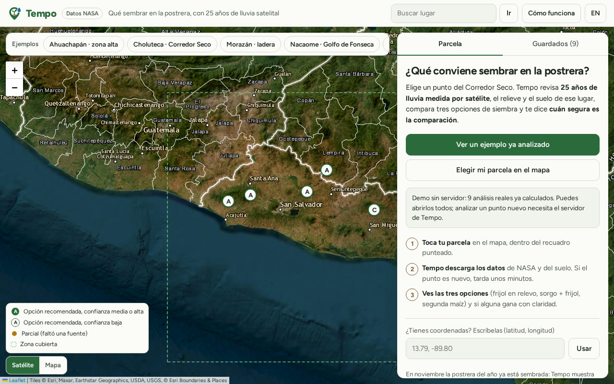
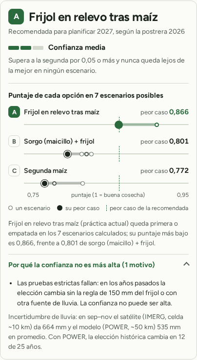
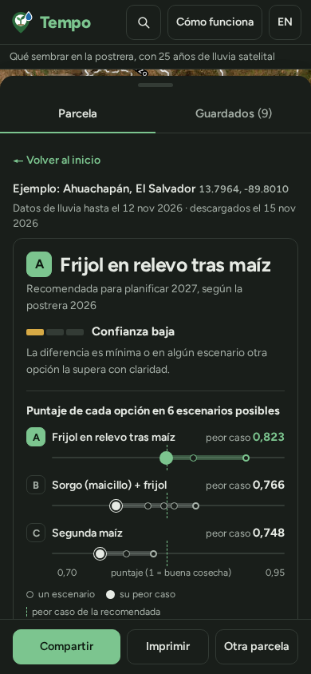

# Tempo para el jurado

Tempo ayuda a decidir **qué sembrar en la postrera** del Corredor Seco centroamericano. Tocas una
parcela en el mapa y Tempo compara tres opciones con 25 años de lluvia satelital de NASA. Recomienda
la que mejor aguanta su peor escenario y dice **qué tan segura** es esa recomendación.



## Abrir la demo (1 minuto)

La demo funciona sin servidor ni credenciales: usa 9 análisis reales ya calculados
(`web/app/demo/`).

```bash
cd web/app
python -m http.server 8000
# abrir http://localhost:8000
```

- Hace falta internet para el mapa (mosaicos de Esri/OpenStreetMap, Leaflet) y la tipografía.
- Abrir `index.html` con doble clic no funciona: el navegador bloquea la lectura de los JSON desde
  `file://`. Cualquier servidor estático sirve.
- Con el servidor completo (`python server.py`, ver README.md) la misma página analiza puntos nuevos.

## Qué mirar

| Clic | Qué ves | Qué demuestra |
|---|---|---|
| 1. «Ver un ejemplo ya analizado» | Ahuachapán: frijol en relevo, confianza baja | La recomendación y su confianza, arriba y en grande |
| 2. Chip «Nacaome · Golfo de Fonseca» | Misma opción, confianza media, gráfico de 7 escenarios | Por qué gana: su peor caso (punto grande) queda a la derecha de los demás |
| 3. «Por qué la confianza no es más alta» | El motivo que frena la confianza | Tempo dice qué supuesto no está validado |
| Extra: tocar el mapa fuera de los puntos | Aviso de que un punto nuevo necesita el servidor | La demo no finge análisis que no hizo |
| Extra: botón EN | Toda la interfaz en inglés | |



Cómo leer el gráfico: cada fila es una opción y cada punto, un escenario (lluvia satelital IMERG o de
modelo POWER, con o sin la regla de 150 mm del frijol, otros suelos). El punto grande es el peor caso
de esa opción. La línea punteada marca el peor caso de la recomendada: las demás opciones caen a su
izquierda en su peor escenario.

En el mapa, cada análisis muestra la letra de la opción recomendada (A, B o C). Relleno verde: confianza
media o alta; blanco: confianza baja.



## De dónde salen los datos

| Fuente | Qué aporta | Resolución |
|---|---|---|
| NASA GPM IMERG V07 (Google Earth Engine) | Lluvia diaria 2001 a hoy | ~10 km |
| NASA POWER | Temperatura, radiación, humedad; segunda fuente de lluvia | ~50 km |
| NASA SRTM GL1 | Elevación y pendiente (corrige la temperatura por altura) | 30 m |
| ISRIC SoilGrids v2 | Arcilla y arena 0–30 cm (agua que guarda el suelo) | 250 m |

El motor (`engine.py`) simula año por año el agua de cada cultivo (balance tipo WRSI simplificado,
parámetros FAO-56), busca los años con una canícula parecida a la actual y puntúa cada opción de 0
(pérdida) a 1 (buena cosecha). La recomendación y la confianza siguen las reglas de DECISIONES.md (D10
rev. 2).

## Límites

- No estima rendimientos ni dinero, y no está validado con cosechas reales.
- La regla de 150 mm de lluvia tardía para el frijol y los parámetros de cultivo son supuestos sin
  validar localmente. Sin esa regla, la elección histórica cambia en 19 a 25 de los 25 años, según el
  punto.
- La lluvia es la de una celda de satélite (~10 km), no la de la parcela exacta; IMERG y POWER a veces
  no coinciden, y la app lo muestra.
- En los 9 puntos de la demo ninguna recomendación llega a confianza alta (7 baja, 2 media).
- La demo no analiza puntos nuevos: eso necesita el servidor, credenciales de Earth Engine y minutos
  de descarga por punto.
- Postrera 2026: ya se sembró; el resultado sirve para planificar la siembra de 2027.
